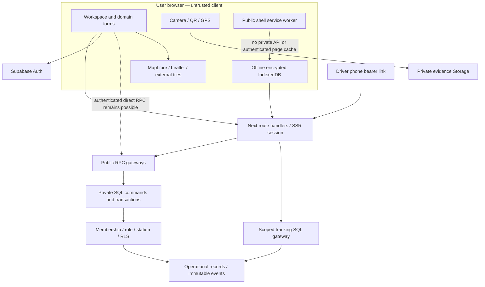

# Architecture and security assessment

This review is read-only. Application source remains at `fa0c03254930ad9f41859eb2e189dd889f51f3ce`; [hash comparison](evidence/architecture-check.json) confirms none of the168 original tracked files changed during artifact generation. The formal source scan used an exact clean clone isolated from audit outputs and has partial coverage:90 fully reviewed source files, plus targeted paths in the large UI components. It found three medium issues. No certification, complete ASVS verification or absence-of-vulnerabilities claim is made.

## Actual architecture

The final dashed relation denotes separate offline facilities, not that the service worker reads the vault. The vault is application-managed; the worker only caches allowlisted public shell/static assets.

`src/app/app/page.tsx` obtains a verified Auth user and dashboard RPC result. `src/components/workspace.tsx` coordinates a local tab/station/modal state and refreshes the dashboard every15s while visible. Delivery tracking polls every8s; station operations every20s while visible. These are separate fetch paths, not a shared realtime event bus. `workflows.tsx` renders many domain forms into one dialog. `/api/command`, `/api/operations` and `/api/field` authenticate and dispatch RPCs; the database remains authoritative for active membership, station scope, roles, evidence and atomic financial/inventory effects.

Hosted evidence: all 20 public tables have RLS; authenticated table grants returned SELECT only. The private evidence bucket is nonpublic,5MB, JPEG/PNG/WebP. All nine repository migrations are listed on the hosted project. [Policies](evidence/hosted-2.json), [functions](evidence/hosted-functions.json), [grants/RLS](evidence/hosted-grants-rls.json), [bucket](evidence/hosted-extra-1.json) and [migration list](evidence/hosted-1.json) are recorded. A function's EXECUTE privilege alone is not sufficient evidence of reachability; schema USAGE, wrapper path and its own authentication guards matter.

## Engineering assessment

| Principle | Current evidence | Proportionate improvement |
|---|---|---|
| Clean/hexagonal boundaries | Browser forms, Next adapters and transactional SQL are distinct, but generic JSON contracts blur domain types | Keep a modular monolith. Typed operation contracts, domain selectors and narrow infrastructure adapters; no ceremonial layer per function |
| Domain-driven design | Deliveries, shifts, credit, work items and field drafts already have different invariants | Use these as module boundaries. Avoid one universal workflow/record abstraction |
| SOLID / cohesion | workspace1710 lines, workflows1135, operations759, offline727; presentation, effects, queries and orchestration coexist | Extract shell, individual workflow forms and a small vault controller. Maintain one owner of each state transition |
| DRY | Repeated status styles, button types, field markup and headers; calculations exist in SQL and preview utilities | Share semantic components and typed contracts; test preview/server numerical parity rather than moving authority to client |
| KISS / YAGNI | Existing monolith and direct RPC fit the deployment | Do not add microservices, Redux, a workflow engine or repository classes without a demonstrated need |
| GRASP / information ownership | SQL knows locked prices/stock/credit; forms know draft input | Keep finance/inventory decisions beside transactions, not in shared visual components |
| Dependency inversion | Browser/storage/map adapters are reasonably narrow; large components call them directly | Introduce testable ports for camera/GPS, field transport and vault persistence only where async/failure testing needs them |
| Coupling / cycles | Static import graph over inventory has no detected cycles | Preserve this. Dynamic imports/CommonJS are outside the simple cycle check; no global assertion of acyclicity |
| State management | Local tabs lack URL/history; offline state has unguarded async lifetime | URL-backed view context; request cancellation/deduplication; vault epoch/session identity. Do not persist private data in URL/localStorage |
| Transaction boundaries | Core commands do multi-record changes in SQL with expected state and locking | Preserve all-or-nothing decant, credit limit, payment and field replay semantics; never split them into UI-driven writes |
| Query architecture | Dashboard recent200, work snapshot500, history100 cursor; polling entire projections | Purpose-scoped queries for archive/history and visible modules; use indexes based on EXPLAIN and actual workload |
| Documentation | schema.sql is byte-identical to initial migration and omits effective later functions/tables | Mark it as initial snapshot or generate authoritative consolidated schema in a disposable DB. Migrations remain source of truth |

### Appropriate patterns

State Pattern is useful as explicit allowed-transition maps/types for deliveries, shifts, work items and offline queue states; SQL still enforces transitions. Strategy applies to grade-dependent thermal/calibration rules already selected by stored data, not pluggable arbitrary scripts. Adapter applies to MapLibre/Leaflet, camera/GPS and field transport, where providers and failure modes differ. Command Pattern already exists in the RPC operation envelope; improve discriminated payload validation instead of adding a second command bus. Observer/domain-event behavior is presently immutable audit/work-item events and polling, not a guaranteed delivery event stream. A monitored outbox becomes appropriate only when real external notification delivery is implemented.

Repository Pattern would add little around the current narrow Supabase calls; prefer domain query functions, adding an interface only for real test/provider substitution. Factory is appropriate for creating a complete validated field draft/request ID, not every component. Facade already describes `serverDb`, browserDb and field/api helpers; keep them narrow. Separation of concerns and good transaction tests matter more than satisfying a pattern checklist.

### Architecture work order

P1: finite SQL domain values, explicit membership acceptance, race-safe vault lifecycle. P1: typed operation schemas and regression tests, shared accessible controls, narrow-screen container constraints. P2: domain form decomposition and URL state adapter; CSS consolidation rather than another override stylesheet. P2: scoped read models, archive/export queries and measured indexes. Later: optional external notifications via outbox; no microservice migration justified by current evidence.

## Validated source findings

| Finding / severity | Source and path | Preconditions and concrete impact | Required boundary |
|---|---|---|---|
| Non-finite numeric strings / medium | mobile migration114 and218–240; API command p unknown | Active Owner/Mu in own station, open shift, valid evidence, crafted request. Lowercase/padded NaN passes raw regex; numeric casts poison persistent nozzle baseline and reconciliation. No cross-tenant escalation established | Reject after numeric parsing, add finite constraints, test direct RPC, all affected quantity/money/coordinate operations |
| Automatic invitation enrollment / medium | app/app/page.tsx13; mobile migration119–130,154–160 | Attacker can own ordinary workspace and pre-invite a memberless target email. Target later authenticates; GET silently binds it to attacker tenant. Revocation blocks normal join. No authentication takeover or existing-tenant disclosure claimed | Explicit recipient-confirmed selected invite; GET read-only; decline/owner-create/recovery model |
| Offline Lock resurrection / medium | offline-terminal.tsx56–64,194–220,569–600 | Legitimately unlocked shared device with pending refresh/save/load. Lock clears state, old continuation restores plaintext and key without passphrase. Local privacy failure; no AES break | Session epoch/handle invalidation on lock/logout/unmount and guards after every await |

A separate **read-only scalar SQL check** confirmed Postgres accepts lowercase/padded NaN and that the current exact-case regex misses it. No poisoned shift was submitted. Invitation exploitation and the asynchronous lock race were source-validated, not exploited against production accounts. Normal offline prepare/lock/unlock passed; that does not disprove a pending-request race.

The tool-generated canonical report, threat model, coverage and SARIF remain in managed security storage. See the absolute links in the artifact-links section below. Findings are not closed by writing this document.

## Security controls and residual requirements

| Area / standard lens | Observed controls | Remaining review or change |
|---|---|---|
| Auth/session — ASVS authentication/session; NIST800-63-4 | Supabase SSR cookies, server getUser checks, proxy refresh and private/no-store | Actual SMTP/redirect delivery, MFA enrollment/step-up, session revocation tests and hosted rate-limit policy not verified. UI/source min12 differs from NIST's15-character single-factor guidance; choose an assurance policy explicitly |
| Tenant/role — ASVS access control; API1/API3/API5 | Membership/station filters, RLS and no direct authenticated table writes; Mu projection omits finance | Preserve DB checks even if UI hides controls. Acceptance-flow issue above must be fixed; test full request matrix in fixtures |
| SQL integrity — ASVS validation; Top10 A06/A08 | Atomic commands, row locks, expected state, evidence and replay checks | Non-finite issue; exact per-operation schemas; failed-command no-write assertions |
| Evidence/storage | Private5MB image bucket, append-only paths, one-use records, short signed access | Browser MIME/GPS/time/photo data remain assertions. Uploader can read own storage objects under policy; SECURITY.md's “owners only” phrasing is too broad. Review actual bytes/decoding defenses and retention; no malware/forgery guarantee |
| CSRF / API boundary | Same-origin checks at state-changing Next handlers; authenticated SQL wrappers | Direct authenticated RPC is an intentional separate boundary; origin headers are not its authorization. Preserve exact resource checks |
| CSP/browser isolation | No framing, nosniff, HSTS, self forms/base/object restrictions and provider allowlists in next.config | script-src unsafe-inline weakens CSP. Evaluate Next-compatible nonce/hash deployment; audit actual scripts and offline compatibility before tightening. No demonstrated XSS claimed |
| Secrets/dependencies — Top10 A03 | Publishable key intentionally public; no application service-role key found; locked packages, Dependabot, pinned Actions | Zero known prod npm advisories is time-bound, not full supply-chain assurance. Restrict optional tile key by domain; no secrets in PR artifacts |
| Driver capabilities | Random32-byte token, SHA256 storage hash,48h expiry, revoke/replace serialization, dispatched-only reporting,20s minimum report interval | Share only intentionally, never log raw links; no issued live-link browser test in this run. Foreground phone GPS is not hardware telemetry or background tracking |
| Offline crypto | AES-GCM256 nonextractable in-memory key; PBKDF2-SHA256600k, random16-byte salt/12-byte IV, actor/workspace/record AAD | Fix lifetime race; physical device threat and browser storage eviction remain. No “offline credit approval” or guaranteed closed-browser sync |
| Logging/monitoring — Top10 A09/A10 | Immutable audit and work-item history; safe API errors | Operational security alert routing, provider outage alerts, client exception monitoring, log redaction and retention unverified |
| Backups/recovery | Source docs call for backups and restore drills | Hosted retention/PITR eligibility, actual restore exercise and incident ownership unverified |

The hosted security advisor currently reports **Leaked Password Protection Disabled**. [Supabase remediation](https://supabase.com/docs/guides/auth/password-security#password-strength-and-leaked-password-protection). This is a deployment configuration warning separate from the three source findings. Do not enable or purchase a plan during an audit-only task. Hosted performance advice reports23 unindexed foreign-key notices plus other informational notices in [raw results](evidence/hosted-extra-0.json). Add only workload-justified indexes after plan measurement, not every suggested index automatically. [Index-advisor guidance](https://supabase.com/docs/guides/database/database-linter?lint=0001_unindexed_foreign_keys).

Standards used as review lenses: [ASVS5.0.0](https://asvs.owasp.org/), [OWASP Top10 2025](https://top10.owasp.org/2025/), [API Security Top10 2023](https://api-security.owasp.org/editions/2023/en/0x11-t10/), [NIST800-63B-4](https://pages.nist.gov/800-63-4/sp800-63b.html). Mapping observations to these frameworks is not a compliance assessment or certification.

## CI/CD and deployment

`ci.yml` pins checkout/setup-node SHAs, Node24, runs npm ci/lint/types/unit/prod-audit/build and protected-route HTTP smoke checks; CodeQL and Dependabot are configured. Existing CI does **not** run the three SQL suites or role-authenticated browser/visual tests. Add ephemeral/local DB tests and scoped synthetic E2E, without exposing deployment secrets to untrusted pull requests. Vercel deployment behavior is integration/configuration, not a new checked-in continuous-delivery workflow invented by this report. Hosted protection settings, branch required checks, promotion policy and rollback drill were not independently verified here. No deployment was triggered.

Read-only Vercel inspection confirms the live alias is a READY production Git deployment from main at the same fa0c032 commit; [saved metadata](evidence/live-deployment.json). This establishes source identity, not verification of all hosted configuration.

## Hardening recommendation

The derived hardening review compares focused local patches with an owned finite-domain parser plus explicit invitation and offline-session lifetimes. It recommends the latter within the existing monolith. All three findings need tactical regressions during migration. No broad service-role server rewrite, event-bus platform or new security service is justified. All latency/memory effects are unmeasured directional expectations; benchmark before claiming an improvement.

## Managed security artifacts and accounting

The security tool reports aggregate accounting for4 threads:19,058,633 total tokens,18,469,760 cached input tokens,79,400 output tokens. This is tool-returned rollout accounting, not a separate billing estimate or this report's source-coverage count. Protected Daybreak knowledge was unavailable; local source review continued. Access: https://chatgpt.com/cyber.

- [Canonical security report](<C:/Users/abdullah fawad/.codex/state/plugins/codex-security/scans/security-audit-source/fa0c03254930ad9f41859eb2e189dd889f51f3ce_20261109T064957Z_cqse2odf/report.md>)
- [Canonical threat model](<C:/Users/abdullah fawad/.codex/state/plugins/codex-security/scans/security-audit-source/fa0c03254930ad9f41859eb2e189dd889f51f3ce_20261109T064957Z_cqse2odf/threatmodel.md>)
- [Coverage](<C:/Users/abdullah fawad/.codex/state/plugins/codex-security/scans/security-audit-source/fa0c03254930ad9f41859eb2e189dd889f51f3ce_20261109T064957Z_cqse2odf/coverage.json>)
- [SARIF](<C:/Users/abdullah fawad/.codex/state/plugins/codex-security/scans/security-audit-source/fa0c03254930ad9f41859eb2e189dd889f51f3ce_20261109T064957Z_cqse2odf/exports/results.sarif>)
- [Derived hardening choices](<C:/Users/abdullah fawad/.codex/state/plugins/codex-security/scans/PumpShield/artifacts-98019800596fe413891cd4f45638df1902b346c211eb23f03821cbd999ac78d4/hardening/hardening.md>)

