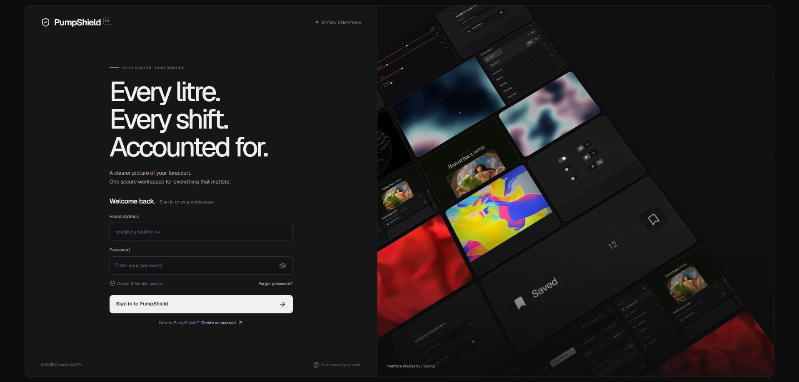
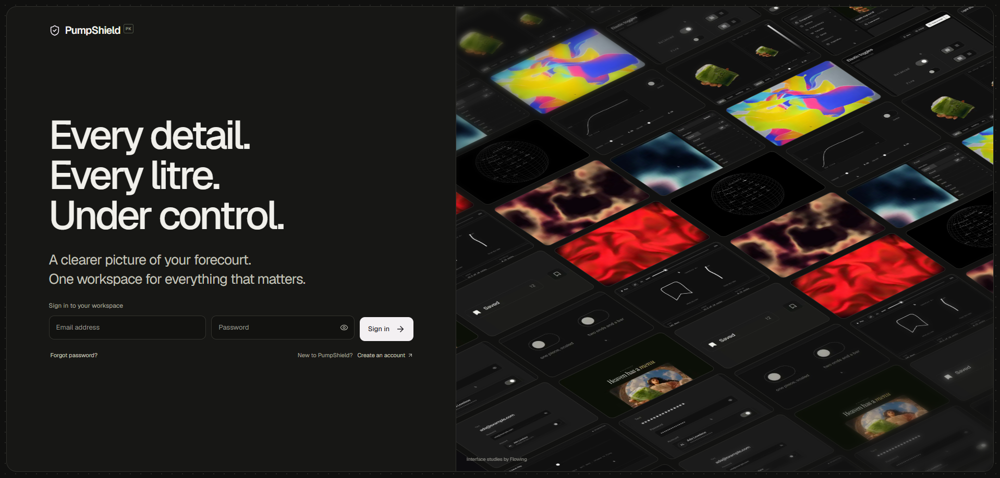

# PumpShield design and workflow review — 8 November 2026

This is a heuristic design review plus browser, API and database verification. It is not a study with petrol-station staff, WCAG certification, or a guarantee that a client station has completed operational acceptance.

## 1. Reference and login — healthy in tested sizes

The previous login used large perspective cards and a dense vertical form. The measured launch reference uses an oblique orthographic plane and a compact form, with the wall above the content on phones. The revised login follows those proportions, removes role-access promotion, and retains real authentication, password recovery and signup.

| Previous PumpShield · 1918 × 918 | Revised PumpShield · 1918 × 918 |
| --- | --- |
|  |  |

[Desktop reference capture](review/2026-11-08/reference-desktop-new.png) · [Phone reference capture](review/2026-11-08/reference-mobile-new.png) · [Revised phone capture](review/2026-11-08/login-after-mobile.png)

- Verified viewport/document widths and heights match at 1366 × 768, 390 × 844 and 320 × 568; no horizontal or vertical page scrolling in the normal login state.
- Signup and reset modes also fit 320 × 568. Input errors use a bounded status region. The visual-viewport handler adapts when the soft keyboard reduces the available height; physical iOS/Android keyboard testing remains a client-device check.
- Recorded reference and PumpShield pointer/wheel sessions in ignored local `output/playwright/reference-motion.webm` and `pumpshield-login-motion.webm`. Reference motion responds to wheel/touch; pointer-position easing was added to PumpShield as requested.
- Reduced-motion emulation: still composition, hidden animated canvas, no playback, and 844px document height at an 844px viewport. Canvas support/media failure retains a local still fallback.
- Automated WCAG-tagged scans reported no violations at the three login sizes tested.

## 2. Operational hierarchy — healthy in sampled screens

Replaced pale lavender text with darker ink/olive, simplified high-level surfaces, and kept semantic status colours. More colour alone did not solve the previous legibility problem: automated contrast checks identified specific text that needed darkening. The interactive map now has a labelled region role so its zoom buttons are not nested inside image semantics. Navigation colour transitions were removed to avoid transient low contrast during selection.

[Overview](review/2026-11-08/overview-final.png) · [Operations desktop](review/2026-11-08/operations-final.png) · [Operations phone](review/2026-11-08/operations-mobile-final.png) · [Documents](review/2026-11-08/documents-final.png) · [Case history](review/2026-11-08/case-final.png)

Design principles applied: visibility of saved state; labelled next actions; recognition through named people and source records; keyboard-operable cards; touch-friendly primary actions; completion reasons; no financial mutation from a drag alone. These choices are explained with source links in [design research](design-references.md).

A browser test exposed a harmful default: when an action disappeared after a transition, the native select could retain a different option. Every new stage now begins with an explicit empty choice and an empty note. The full case flow verified both resets before resolution.

Automated rules: `wcag2a`, `wcag2aa`, `wcag22aa`. Overview, operations, document centre and case history had no violations after their finite UI transitions settled; mobile supervisor operations also had no violations. The saved owner result is [here](review/2026-11-08/axe-owner.json). These are sampled views and rule coverage, not a whole-product conformance statement.

## 3. Business workflows — verified across browser, API and database

| Story | Evidence/result |
| --- | --- |
| Owner creates a case, investigates and resolves it | Browser submissions returned HTTP 200; saved stage and chronological notes appeared in the UI and database. No action or old decision note was selected automatically after advancing. |
| Incoming supervisor accepts a handover | Real Munshi session accepted the sample briefing; database status became `accepted`. Sender acceptance and self-handover creation were rejected in SQL checks. |
| Owner-only case confidentiality | Cases and document navigation absent from supervisor UI; owner-case history returned HTTP 404 to supervisor. Cross-tenant and revoked-member checks passed. |
| Supply request through physical receipt | SQL integration ran requested → approved → linked dispatch → real delivery decant → received. Receipt before decant was rejected; receipt did not post inventory twice. |
| Maintenance closure | Invalid jumps and empty completion notes rejected; assigned person could start and complete with a note. |
| Record integrity | Direct table updates and history deletion denied. Stale expected state rejected. Unique partial index prevents two active indents linking the same delivery. |
| History performance | Board snapshot excludes bulk comments; an authorised detail request returns up to 100 events with an older-entry cursor. Board capped at 500 most recently updated station items. |
| PDF retrieval | Authenticated claim and account statement responses returned HTTP 200 and `application/pdf`; both were rendered and visually inspected. Shared wrapping/pagination tests passed. |
| Public endpoint guards | Anonymous operations request returned 401; foreign-origin mutation returned 403. These checks were added to CI. |

[Rendered claim](review/2026-11-08/claim-verified.png) · [Rendered statement](review/2026-11-08/statement-verified.png)

Validation: lint, TypeScript, eight calculation/PDF tests, production build and production dependency audit passed. The database suite and new operations suite ran against hosted Postgres inside rolled-back transactions. Synthetic fixtures did not survive those SQL suites. Browser evaluation left clearly labelled demonstration work items in the isolated Design Lab; existing station deliveries, shifts and balances were not reset.

## Remaining acceptance work

The technical checks support releasing these workflows for client review. Physical station device/camera/keyboard testing, agreed calibration and accounting balances, production SMTP, notification delivery and backup restoration remain rollout work. The hosted security advisor still reports leaked-password protection disabled; [Supabase configuration guidance](https://supabase.com/docs/guides/auth/password-security#password-strength-and-leaked-password-protection). No missing RLS/security-function advisor warning was returned for the new schema. Existing informational performance advisories are not represented as resolved.

The [roadmap](product-roadmap.md) distinguishes shipped workflows from receivable allocation, tax-invoice requirements, reorder forecasting, service evidence/reminders and customer-portal work that needs further requirements or provider setup.
