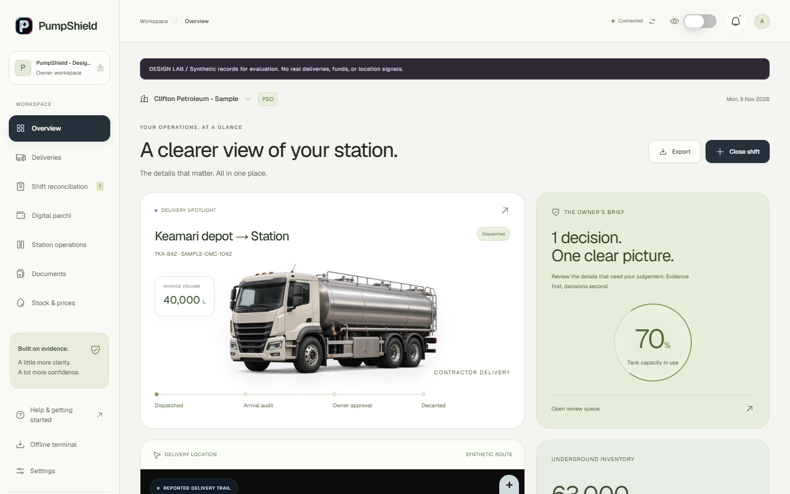
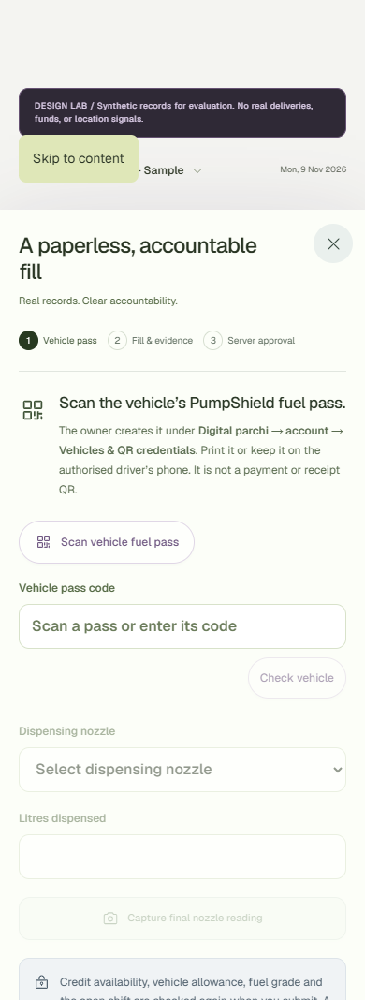
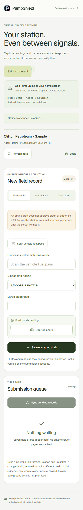
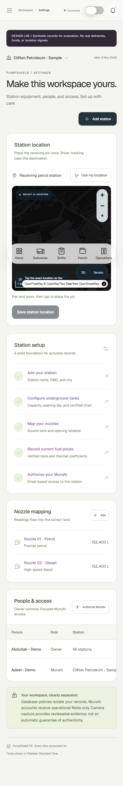

# Mobile field workflows and verification — 9 November 2026

This release replaces the login wordmark with an original glass P/drop mark, adopts Phosphor's consistent icons and clarifies the parchi, driver-link, station-pin and offline workflows. Existing accounting and approval gates remain authoritative.

## Workflow review

1. **Owner-issued fuel pass:** create a corporate vehicle, print its pass, then scan it from Digital parchi. The form explains what to scan, displays the matched registration/account/grade/allowance, and requires a final nozzle photo. Invalid payment/receipt codes are rejected. Vehicle-pass PDFs are owner-only and private; their QR credentials are not included in this public review.
2. **Delivery link:** choose receiving station and loading depot on the map, create a 48-hour link, then open native sharing, WhatsApp, SMS or copy. The user sends the message. Driver consent starts phone GPS reports; stop, revocation, expiry or arrival-audit status prevents further accepted reports. Browser background tracking is not guaranteed.
3. **Map:** pick a station pin or use current-device geolocation. The tanker rotates/interpolates between received positions, never beyond them. The trail connects reports and is not a verified road route. Stale reports remain visibly stale. A missed WebGL/style load falls back to a standard map.
4. **Offline:** sign in online, prepare the assigned station with a separate passphrase, install/add to home screen, capture a draft, and reconnect with the terminal open/unlocked. Original shift identity is retained. The server verifies current permission, evidence, grade, allowance and financial constraints. A review state blocks later queued operations, including shift closure.

## Evidence and corrections

- Production build, TypeScript, ESLint and 12 unit/PDF/field tests passed. New encryption tests exercise wrong passwords, replacement of a record's ciphertext, tenant binding and preservation of existing vault data.
- All three administrator-run SQL suites passed with rolled-back fixtures. Field checks cover one-time credit posting, lost-response replay after closure, conflicting payloads, evidence reuse/age, closed original shifts, credit limits, cross-tenant/role denial and revocation.
- Browser QA used owner and Munshi Design Lab accounts. Both authenticated; Munshi preparation returned only its assigned station and successfully reloaded/unlocked offline. A synthetic camera/GPS fixture exercised capture, encrypted persistence across offline reload, reconnection and server rejection of an unissued vehicle pass. No real fuel fill was created by that test.
- Service-worker cache inspection found 23 initial public entries and zero private API/app/auth/driver-link entries. Favicon caching was subsequently added; no private cache rule was broadened.
- A browser check exposed MapLibre 6's worker URL requirement and a CSS position collision that collapsed its container. The worker is now served from the pinned installed package; map surface specificity and explicit dimensions fixed selection. Mobile map clicking returned coordinates with no horizontal document overflow.
- Desktop and 390px mobile screenshots were inspected. Contrast checks identified low-contrast step labels, nozzle totals, active badges and kiosk hints; their text colours were darkened. Radix dialogs retain keyboard focus containment and Escape dismissal; capture buttons use large touch targets. These are practical HCI checks, not accessibility certification.
- Final automated WCAG 2 A/AA and 2.2 AA checks reported zero violations on overview, settings/map, login, mobile parchi and unlocked offline terminal. Login had no document overflow at 1440×900, 1366×768, 390×844 or 360×640. Real station-device and screen-reader testing remains necessary.
- The generated sample fuel-pass PDF was rendered, visually inspected and decoded through the actual browser QR scanner using a synthetic camera feed. It matched the correct vehicle and enabled the evidence step. No credit fill was submitted. This does not replace a physical phone/printed-pass acceptance test.
- Tracking lifecycle changes serialize replacement/revocation on the delivery and order new sessions by actual issue time. The database suite verifies that replacement invalidates the old capability and the newest active session is returned.

## Captured screens

## Research and choices

- [Apple app-icon guidance](https://developer.apple.com/design/human-interface-guidelines/app-icons) informed the original refractive mark; Apple branding was not copied.
- [Phosphor React](https://github.com/phosphor-icons/react) supplies a coherent open-source icon family with individual imports.
- [MapLibre installation guidance](https://maplibre.org/maplibre-gl-js/docs/) informed local version-matched ES module workers and lazy loading. [OpenFreeMap](https://openfreemap.org/) supplies the default vector map, and [AWS terrain tiles](https://registry.opendata.aws/terrain-tiles/) supply optional elevation. Licensed satellite imagery requires a restricted MapTiler key; it is not represented as configured.
- [Next.js PWA guidance](https://nextjs.org/docs/app/guides/progressive-web-apps) informed installation and the separate public shell. The field queue deliberately requires an open unlocked terminal instead of promising unsupported closed-browser sync.

## Limits and launch work

The Codex Security source review produced no reportable findings in the reviewed critical paths, with **partial coverage**. Independent workers hit an account usage limit. The tool binds its report to the scan-start snapshot and warns that the worktree changed during implementation; it does not certify the final release. A broader independent review remains appropriate. Tool-reported usage was 16,589,990 tokens total, including 16,216,576 cached tokens; this is the tool's thread accounting, not a separate billing estimate.

Production SMTP, leaked-password screening on an eligible Supabase plan, MFA policy, backup/recovery drills and monitoring still need operational configuration. Test the actual station's phone cameras, QR print size, permissions, sunlight readability, connectivity loss and passphrase recovery procedure before business-critical adoption. Browser photo/GPS/time values remain untrusted assertions. See [security controls](../SECURITY.md).
