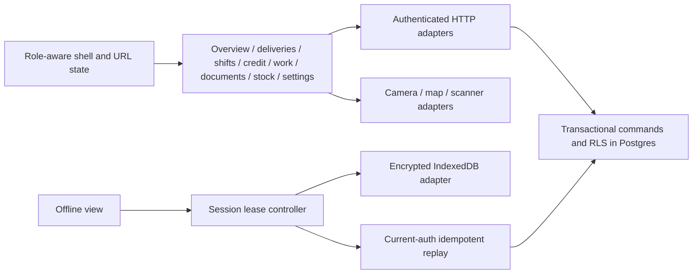

# PumpShield redesign implementation and verification

This report describes local implementation on `codex/petroleum-ledger-redesign`, based on audit commit `fa0c03254930ad9f41859eb2e189dd889f51f3ce`. The original audit and concepts are preserved under `artifacts/pumpshield-audit`. They are discovery evidence, not the current interface. This branch has not been pushed or deployed, and no hosted migration or Auth configuration was changed during implementation.

## Delivered interface

The selected Petroleum Ledger system uses warm paper `#F5F3EE`, white surfaces, charcoal `#202724`, secondary text `#58645F` and petroleum `#174C45`. Meaningful success, warning, error and information colors remain distinct. Geist is preserved. New composition belongs to `workspace.css`, `overview.css` and the workflow domain stylesheet; superseded editorial workspace rules and unused intermediate overview styles were removed. Some older global/domain CSS remains and should be consolidated only with route/state coverage.

The new original vector P monogram replaces the glass bitmap mark, including favicon and install icons. The existing Flowing-style login layout, pointer canvas and artwork are preserved. Signup/recovery validation changed for the security policy; the login page was not replaced. Public login/signup/recovery captured at all eight sizes fit one viewport.

### Context-aware, customizable Owner overview

- A generated, optimized transparent tanker illustrates the selected incoming delivery. Previous/next controls select real records; invoice volume, depot, receiving station, compartments, loading temperature, measured arrival and verification stage come from the authorized register. The image is labelled illustrative. No invented speed, battery, ETA, driver identity or road progress appears.
- Stage controls filter the loaded register. The selected load opens its own receiving record or lazy-loaded tracking/sharing panel. No driver capability is created merely by opening the panel.
- Daily shift bars select actual Pakistan-calendar observations and open their associated shift records. The seven/thirty-day selector recomputes loaded closed-shift totals. Missing days are not fabricated as zero sales; invalid legacy observations are excluded with a warning.
- Tank cutaways represent recorded stock/capacity. Select a tank to see its linked saved nozzle totalizers. These are ledger counters, not live hardware readings. Physical dip verification remains explicit.
- Payment-ring controls inspect Cash/POS/Credit from submitted shifts. Direct labels, keyboard controls and privacy masking accompany the visual.
- The review queue remains visible and cannot be hidden; larger queues disclose additional records on demand. Optional panels can be hidden/reordered using labelled controls. Versioned browser storage contains only allowlisted layout identifiers, scoped to actor/workspace/station, not business values.
- The audit activity list is accurately labelled workspace-wide, with human-readable operation names.

This implements the user's choice of context-aware customization. It is not an LLM assistant and does not send business data to an AI provider. See [asset provenance and operational concepts](visual-assets-2026-11-09.md) for the exact imagegen prompt, final asset and later concepts that require additional data models.

### Shell and operational modules

- Validated URL state preserves authorized module/station/record/search context across back/reload. Cross-station, unknown and unauthorized resource identifiers are rejected. Bearer credentials and financial payloads never belong in these URLs.
- Stable five-item mobile navigation, compact headings, readable controls, native numeric input modes and full-height narrow dialogs replace the previous desktop compression.
- Deliveries and station work render boards on desktop and actionable lists on phones. Only the active presentation mounts. Stage filters, current workflow step, evidence checks and lazy tracking remain tied to existing server guards.
- Munshi “New delivery” was removed after QA confirmed the command is Owner-only. This fixes an affordance; the server restriction already existed.
- Shift reconciliation has an extracted responsive register. Parchi explains owner-issued vehicle passes progressively; malformed passes keep dispensing locked. Stale evidence is cleared when the selected record changes.
- Vehicle disabling includes explicit confirmation. Dialog Escape/close returns focus to the invoking action.
- Document/export labels describe the loaded/recent scope. PDF rendering preserves supported accents, units, source and generation metadata and handles long statements; unsupported scripts receive visible replacement notation and a warning. Full Urdu shaping is not implemented.
- Read-only endpoint checks returned a valid PDF to the Owner and a resource-hiding404 to the Munshi for the same approved sample claim, consistent with row-level access. Actual map tiles also rendered with MapLibre controls enabled; no station pin or location was saved.

## Domain and security changes

The additive migration is `supabase/migrations/20261109115526_secure_domain_boundaries.sql`:

1. Finite numeric parsing at SQL command/calibration/field/tracking/operations boundaries, plus numeric/JSON persistence constraints. Preflight stops on existing invalid values; it never silently repairs stock or money. Operation-specific Zod contracts provide HTTP feedback while SQL protects direct RPC callers.
2. Read-only onboarding choices and explicit accept/decline of a selected, expiring invitation. GET page rendering no longer accepts an invitation or creates membership. Existing membership, revocation, tenant/station assignment and idempotency guards remain authoritative.
3. Offline session leases invalidate in-flight work after Lock/logout/unmount/identity changes. Guarded awaits cover network, cryptography and IndexedDB, preventing a late continuation from restoring an old key/context. The encrypted vault format and pending-draft namespace were preserved.

New-password enrollment/recovery checks 15–128 Unicode code points without composition rules or trimming. HTML bounds allow UTF-16 representation without truncating valid supplementary characters; existing sign-in input is not capped/truncated by that new policy. Hosted minimums, SMTP, MFA and leaked-password settings still require live configuration verification.

This is remediation of identified boundaries, not a guarantee of an entirely vulnerability-free application or a compliance certification. Existing no-store, RLS, append-only evidence, transaction, capability expiry and approval controls are preserved. CSP still permits inline script/style for the current Next/offline integration; a nonce/hash rollout requires separate verified work.

## Architecture

The application remains a modular monolith. SQL owns financial/inventory transaction boundaries; authenticated HTTP routes adapt typed commands; the UI presents records and previews. No microservices, replacement UI framework, chart dependency or AI backend was introduced.

Focused extractions include `owner-overview`, `overview-performance`, `overview-payment-mix`, `receiving-focus`, `shift-register`, `use-offline-terminal`, `overview-model` and `workspace-navigation`. The large workflow switch and remaining legacy CSS are still refactoring debt; they were not replaced wholesale at the expense of existing invariants. Polling has explicit request ownership/cancellation and retains last-good data. Global historical queries/exports and a measured realtime strategy remain separate product work.

## Verification and evidence

The [real screenshot gallery](../artifacts/pumpshield-redesign/gallery.html) and [verification summary](../artifacts/pumpshield-redesign/verification.json) contain the final counts and measurements. Images depict the running local production build using the approved synthetic Design Lab, not generated mockups. Eight sizes: 1920×1080,1440×900,1366×768,430×932,390×844,360×800,320×640,768×1024. Mobile/touch/scale emulation is not physical-device acceptance.

- Lint, TypeScript, 39 unit tests in nine files and production build passed. Production dependency audit reported zero known vulnerabilities at execution time.
- All ten migrations applied cleanly in an unexposed disposable PostgreSQL17 container, followed by four rolled-back SQL suites. These verify domain transitions, tenant/role boundaries, evidence/credit/stock/replay invariants, numeric rejection/no-write behavior and explicit invitation consent. Auth/Storage are fixture schemas, not full running Supabase services.
- Owner overview checks verified chart totals against actual returned records; period changes, drilldown record identity, panel persistence/reordering/reset, privacy and delivery-stage filtering. Additional browser checks verified decoded tanker image, delivery selection, selected record/map reads, tank-to-nozzle correspondence, payment-category interactions, empty stage and dialog focus return.
- Both roles navigated the current screens. Delivery blank-form validation produced no command posts. Munshi invalid-pass handling remained locked and Owner controls were absent. Exact focus return and sampled axe states were tested; final accessibility retest details are in the verification summary. Zero axe findings in sampled states is not WCAG certification.
- A real context200 response was held and released after Lock. It did not restore decrypted context or forms. Actual navigator-offline state, cached-shell reload and offline unlock/lock passed. CacheStorage contained public assets only; private API access failed offline and the online dashboard response was `private, no-store`. No drafts were posted; the fresh empty test vault was removed.
- Three cache-disabled mobile CPU4× production measurements are included with exact conditions. They are local laboratory observations, not field Core Web Vitals or a controlled before/after percentage. Initial remote data is server-rendered; an empty client API list does not mean zero server database queries.

### Not verified / not released

- No financial, inventory, membership or real-station mutations were made through the hosted browser session. A complete browser→real Supabase Auth/Storage→SQL lifecycle on a separate disposable Supabase project remains a release gate. SQL fixture tests are not a substitute for that test.
- Physical printed-pass scanning, actual camera capture, mobile browser permission flows, station GPS accuracy and background tracking limits need supervised device acceptance. No GPS location reports or driver-link messages were sent.
- Hosted migration, SMTP, MFA/leaked-password policy, backups, monitoring and restore drill were not changed or certified. CI job changes were exercised by the local harness/build; GitHub-hosted execution remains pending push.
- Full Urdu/RTL PDF typography, arbitrary historical reporting, road routing/ETA, automated messaging, OCR and additional role types are outside this delivered scope.

## Rollout and recovery

1. Review the branch/diff and current configuration. Confirm a separate preview database and a tested backup/restore path before any hosted schema work.
2. Run the migration preflight on a reviewed staging copy. If invalid financial/inventory values exist, stop and agree an explicit repair; do not coerce or overwrite them automatically.
3. Apply the additive migration before releasing the new onboarding UI. Verify read-only onboarding, explicit recipient choice and current membership/revocation with isolated users. Confirm the hosted password policy and recovery redirects/SMTP.
4. Run the full isolated browser lifecycle and supervised device acceptance. Require the existing quality/security checks plus the new clean-migration/domain job before promotion.
5. Deploy a protected preview, inspect actual devices, then promote only after approval. This task did not push or deploy.
6. Keep additive security constraints when rolling forward/fixing UI. Do not blindly revert to the old GET auto-join page against the new semantics: it can create unintended workspace behavior. Prefer a reviewed forward fix or maintenance route while retaining ledger history and explicit consent.
7. Service-worker cache version3 refreshes public assets, while the encrypted IndexedDB schema is preserved. Never clear client vaults to fix a release; unsynced drafts require a specific recovery plan.
